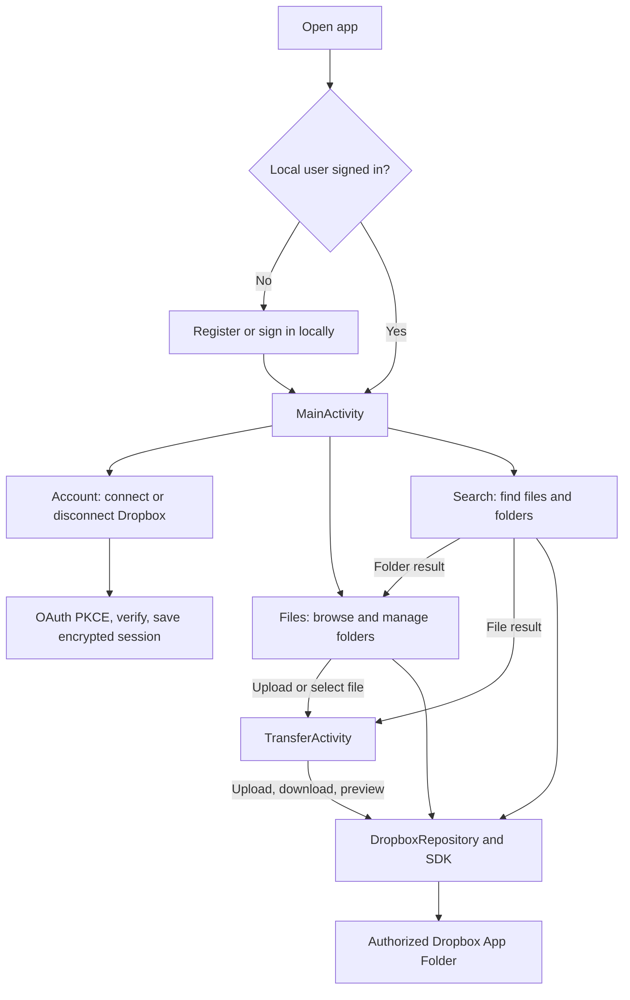

# Dropbox Client Android

A six-member USTH Mobile Application Development project built with **Java and XML** (`vn.edu.usth.dropboxclient`). The app uses a local account for entry and a separately authorized Dropbox account for real cloud operations. Dropbox access is limited to the Developer App's **Scoped App Folder**.

## Features

- Create and sign in to a local account without a personal email. Local logout keeps the device's Dropbox connection; **Disconnect project storage** removes it explicitly.
- Connect Dropbox with OAuth 2.0 PKCE and verify the connection with `DropboxRepository.getCurrentAccount()`. Account shows only the local username and Dropbox connection state; it does not display profile names, email addresses or a Dropbox account ID.
- Browse root and nested folders, return to a parent folder, refresh and load more pages. Files, empty folders and errors have visible states.
- Search the authorized App Folder with Dropbox `files.searchV2`, open a matching folder in Files, and load more search results.
- Create, rename and delete folders with validation, conflict feedback and delete confirmation.
- Upload from Android's document picker into the folder currently open in **Files**. Tap a file for details and use **Download from Dropbox** to choose a local save destination.
- Preview JPG, PNG, WEBP, GIF and PDF files up to 20 MiB in an installed Android viewer. The app checks both reported size and actual downloaded bytes, and shares only a temporary read-only content URI. Preview copies older than 24 hours are removed when preparing another preview.

The local account is a coursework entry mechanism, not a production identity service or a separate Dropbox account for each user. Local accounts on the same device share its authorized project App Folder.

## Application workflow

1. Register or sign in with a local username. The app opens **Account**, **Files**, and **Search** in `MainActivity`.
2. In **Account**, choose **Set up project storage**. Dropbox OAuth 2.0 PKCE authorizes the App Folder; the app verifies the connection and saves the credential encrypted on this device. Files and Search need this connection.
3. In **Files**, browse folders, refresh or load more entries, manage folders, upload a document, or tap a file to download or preview it. **Search** finds files and folders by name; a folder result opens in Files, while a file result opens the transfer screen.
4. File and folder requests go through `DropboxRepository` and the Dropbox SDK to the authorized App Folder. Local **Log out** returns to sign-in but keeps the shared Dropbox connection; **Disconnect project storage** removes that connection from this device.



## Run

1. Open this repository's root in Android Studio. Use the bundled JBR 21 and Android SDK 36.1; the app supports Android 8.0 (API 26) and later.
2. Allow Android Studio to create the ignored `local.properties` for your SDK. To use the real Dropbox API, add `DROPBOX_APP_KEY=your_app_key` there and rebuild. The App key is a public application identifier; never commit a password, token or App secret.
3. In the Dropbox Developer App, enable `account_info.read`, `files.metadata.read`, `files.content.read` and `files.content.write`. Save changes and authorize again if scopes changed.
4. Run `app` on an emulator or Android device. Create a local username and password, open **Account > Set up project storage**, and approve the Dropbox request.
5. Open **Files** to browse and manage the App Folder. Use **Upload file** in the current folder; tap a file to preview or download it. Use **Search** to find a file or folder by name.

For a presentation sequence and explanation of the code path, see [Run and present the app](docs/run-demo-vi.md).
For a short talk track with a live demo order and likely questions, see [Vietnamese presentation script](docs/presentation-script-vi.md).

On Windows, verify the project with:

```powershell
.\gradlew.bat assembleDebug assembleDebugAndroidTest testDebugUnitTest lintDebug
```

## How it works

```text
LoginActivity (local account)
  -> MainActivity
     -> FileBrowserFragment / SearchFragment / AccountFragment
        -> DropboxRepository
           -> DbxClientV2 -> Dropbox API
```

`SessionManager` encrypts the Dropbox credential with Android Keystore and excludes it from backup. `DropboxClientFactory` creates the SDK client. File transfers and previews use `TransferActivity`, `TransferViewModel` and `DropboxTransferService`; previews are exposed to a viewer through `FileProvider`. Network and file I/O run on worker executors; UI updates return to the main thread.

## Verification and limits

On 26 October 2026, the updated source passed the app/test APK builds, **41/41 unit tests**, and lint with **0 errors, 8 warnings**. The Pixel 10 instrumentation suite reported **19 passed, 4 intentionally skipped live tests, 0 failures**. Coverage includes local login/logout, folder and transfer services, exact-byte streams, preview limits and private content URIs, picker cancellation, invalid paths, unsupported previews, missing Dropbox connections, and transfer-screen recreation.

The opt-in UI/API acceptance test also passed on authorized Pixel 6: **Files → upload → download → Search → preview**, using the real Dropbox API and exact-byte comparison. Picker results and viewer launch were intercepted by the test; manually choosing a document and rendering it in an installed viewer remain manual acceptance steps. Earlier live checks verified account lookup, folder listing and folder create/rename/delete. See [transfer acceptance](docs/transfer-review.md). Account intentionally shows only the local username and connection state.

Use small files. Preview requires an installed viewer, is limited to 20 MiB and caches a temporary copy in app storage. Large upload sessions, background recovery, progress percentages, and automatic retry of uncertain writes are outside this MVP. A failure after a download starts writing may leave a partial destination. Each newly installed device must complete its own Dropbox authorization.

[Team development without shared credentials](docs/team-development.md) explains how members build and test without sharing the project's Dropbox login.
