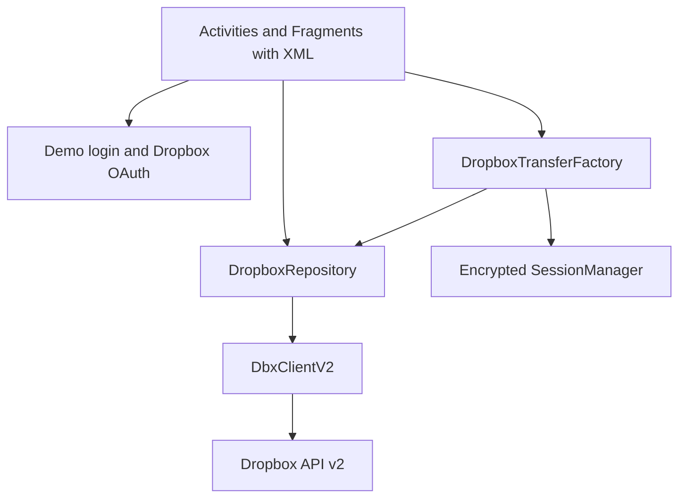

# Dropbox Client Android

Android group project for the Mobile Application Development course at USTH. The academic demo uses local username accounts and a shared Dropbox connection. It currently demonstrates real account lookup and small-file transfers using **Java and XML layouts**.

## Project status and scope

The Java/XML skeleton and local demo login are implemented. A separately authorized Dropbox connection has passed live account lookup and small-file transfer checks on one demo device. The file browser and create/rename/delete screens are still pending. Only Dropbox is in scope; Box, multiple providers and offline synchronization are excluded from the MVP. No custom backend, Firebase or Compose is planned.

### Current implementation

- Confirmed package and application ID: `vn.edu.usth.dropboxclient`.
- `LoginActivity` registers and authenticates device-local demo users by username; personal email is not required. `ProjectDropboxActivity` handles one-time project-account OAuth setup separately.
- `MainActivity` hosts `FileBrowserFragment` and `AccountFragment` with working Files / Account navigation.
- `AccountFragment` shows the local demo username and the independent project-storage connection. When configured, it loads the Dropbox display name through `DropboxRepository` on a background executor. Demo logout preserves the Dropbox connection; a separate Disconnect action removes it. Files remains a placeholder.
- The debug transfer screen uses the authorized project connection for small-file upload/download. On 22 October 2026, a Pixel 6 API 34 test passed real Dropbox account lookup, folder listing, upload and byte-for-byte download verification.
- The project builds and runs on a Pixel 6 emulator with Android 14 (API 34).
- Current validation on 22 October 2026: build passed, 14 unit tests passed, 12 isolated device tests passed, and the opt-in live Dropbox round trip passed 1/1. Lint reported 0 errors and 8 warnings.

Milestone 1 remains open until another team member completes a clean clone, Gradle sync, build and run.

## Feature priorities

| Priority | Features | Acceptance criteria |
|---|---|---|
| MVP | Local demo login and Dropbox connection | Register/login without email; connect Dropbox; show account; distinguish demo logout from cloud disconnect |
| MVP | File/folder browser, folder navigation, refresh | Browse root and nested folders; return to parent; handle pagination and empty folders |
| MVP | Create folder, rename, delete | Validate names; show conflicts; confirm deletion; refresh after success |
| MVP | Upload and download | Select a local file and destination using Android file pickers; verify uploaded/downloaded content |
| MVP | Loading, empty and error states | No crash on cancellation, network failure or expired authorization; allow retry |
| Optional after MVP | Search, shared links, image/PDF preview, transfer percentage, dark mode | Separate issues; implement only after MVP passes |
| Out of MVP | Offline cache/sync, multi-provider support | No delivery commitment |

## Technology and architecture

- Java, XML, Android Studio, Activity, Fragment, Intent and Android resources. RecyclerView is planned for the file browser.
- `minSdk` 26, `targetSdk` 36 and `compileSdk` 36.1.
- Java 11 source compatibility; the verified build uses Android Studio's bundled JBR 21.
- Dropbox API v2 over HTTPS uses the official Java/Android SDK 8.0.2. SDK objects represent API responses; the presentation should still explain HTTP, JSON and OAuth.
- Simple layered design. Application logic stays small; do not create a controller class for every action without a need.
- Implemented account and transfer work runs on executors; UI updates return to the main thread. Remaining screens should follow the same pattern.



`LoginActivity` handles local demo login and opens `MainActivity` on the Account tab. OAuth starts from **Set up project storage**. `MainActivity` hosts `FileBrowserFragment` (currently a placeholder) and `AccountFragment`. The debug transfer screen uses Android document pickers; general browsing and create/rename/delete UI remain team tasks.

### Current structure

The package name is confirmed as `vn.edu.usth.dropboxclient`. The current source structure is:

```text
Dropbox-Client-Android/
  app/src/main/
    java/vn/edu/usth/dropboxclient/
      auth/
      repository/DropboxRepository.java
      ui/login/
      ui/main/
      ui/files/
      ui/account/
      ui/transfer/
    res/layout/
    AndroidManifest.xml
  docs/
  gradle/wrapper/
  README.md
```

`DropboxRepository` currently handles account lookup and upload/download API calls. The debug transfer screen delegates cloud operations to it and performs network/file I/O on a worker thread. The team should agree on repository contracts before adding file browsing and create/rename/delete operations.

## Milestones and team

Milestones are completion gates, not calendar deadlines. There are nine gates M0-M8.

| Gate | Deliverable | Status and remaining evidence |
|---|---|---|
| M0 | Scope and roles | Partial: MVP recorded; replace proposed role numbers with agreed owners |
| M1 | GitHub and Android skeleton | Partial: local build/run passed; a second member's clean clone is unverified |
| M2 | Dropbox configuration and OAuth | Partial: real authorization/account lookup passed; cancellation, expiry and refresh need full device checks |
| M3 | File browser | Pending: Files tab is a placeholder |
| M4 | File operations | Pending: create/rename/delete UI and acceptance checks |
| M5 | Transfers | Partial: real small-file API round trip passed; manual picker and failure checks remain |
| M6 | Integration and UI | Pending: full browser/operations flows and lifecycle checks |
| M7 | Testing | Partial: current module tests passed; full MVP regression remains |
| M8 | Documentation and demo | Pending: slides and complete rehearsal |

| Member placeholder | Technical ownership | Review partner |
|---|---|---|
| 1 | Skeleton, navigation, contracts and integration | 3 |
| 2 | OAuth, account data and session | 6 |
| 3 | RecyclerView, pagination and folder navigation | 1 |
| 4 | Upload/download, file URI handling and transfer errors | 5 |
| 5 | Create/rename/delete and validation | 4 |
| 6 | Account UI, shared UI states and regression support | 2 |

Replace proposed role numbers with the actual owners' names/GitHub handles. All members should test their module, review PRs and contribute to README/slides. Mock-based development does not require the shared Dropbox credentials; live checks require an authorized device. Optional preview remains optional for Member 6.

## API configuration

1. Create a scoped app in the [Dropbox App Console](https://www.dropbox.com/developers/apps). The project uses **App Folder** for an isolated academic demo. Use the dedicated project account; file paths are relative to the app folder.
2. Enable only required scopes: `account_info.read`, `files.metadata.read`, `files.content.read`, `files.content.write`. Add sharing scopes only if shared links are approved. Reauthorize after scope changes as required.
3. Use OAuth 2.0 authorization code flow with PKCE. Do not embed an app secret or use a manually generated personal token as the application's login flow.
4. Set `DROPBOX_APP_KEY=YOUR_APP_KEY` in ignored `local.properties` or an environment variable. Gradle passes this public client identifier to the SDK and generates the matching OAuth callback scheme; never commit tokens or an App secret.
5. The app already declares `android.permission.INTERNET` and the SDK `AuthActivity` callback in `AndroidManifest.xml`. Complete OAuth from **Account > Set up project storage** and check that the app returns to Account.
6. `SessionManager` encrypts the Dropbox credential with Android Keystore. Demo logout keeps the shared project connection; **Disconnect project storage** removes it from the device.
7. The project pins Dropbox SDK 8.0.2 in `app/build.gradle.kts`; verify JDK, AGP, Gradle and Android SDK compatibility before changing that version.

Source: [official SDK setup](https://github.com/dropbox/dropbox-sdk-java), [OAuth guide](https://docs.dropboxapi.com/dropbox-api/docs/oauth), [file access guide](https://docs.dropboxapi.com/dropbox-api/docs/file-access). Recheck compatibility when selecting the dependency.

## Setup and running

Requirements:

- Android Studio with Android SDK 36.1 installed.
- JDK 21 for Gradle. The JBR bundled with Android Studio is recommended.
- Android emulator or physical device running Android 8.0 (API 26) or later.

1. Clone the repository:

   ```powershell
   git clone https://github.com/NamICT135/Dropbox-Client-Android.git
   ```

2. Open the cloned repository root in Android Studio and wait for Gradle sync.
3. Allow Android Studio to create the machine-specific, ignored `local.properties` file.
4. Select a compatible emulator or device and run the `app` configuration.
5. Register or log in with a local demo username, then check Files / Account navigation. To call the real Dropbox API, connect project storage from Account.

Local demo login works without Dropbox configuration. Real account and transfer calls require an authorized Dropbox connection. Do not paste tokens or credentials into source files.

Use the committed Gradle wrapper. On Windows, run:

```powershell
.\gradlew.bat assembleDebug lintDebug testDebugUnitTest
.\gradlew.bat connectedDebugAndroidTest
```

The build, unit tests and lint passed on 22 October 2026. On an authorized demo device, use the direct instrumentation commands in [Transfer acceptance and limitations](docs/transfer-review.md) so the test runner does not remove the saved connection. The live account and small-file transfer test also passed on Pixel 6 API 34.

## Git and GitHub workflow

- Invite the other five members as collaborators; use Issues with owner, acceptance criteria and milestone. Track To do -> In progress -> Review -> Done.
- Keep `main` stable. Work on `feature/auth`, `feature/file-browser`, `feature/upload-download`, `feature/file-operations`, `feature/account`, or `feature/ui-testing`; use `fix/...` for focused fixes.
- Update from `main`, implement a small task, inspect the diff, commit and push your branch, then open a PR. Require a peer review and relevant build/test evidence before merging. Enable branch protection where available; do not push directly to `main`.
- PRs describe behavior, screenshots for UI changes, test evidence and known limits. Coordinate shared files such as Gradle, Manifest, navigation and DropboxRepository with their owners.
- Use clear messages such as `feat: paginate Dropbox folders`, `fix: handle cancelled login`, `docs: explain OAuth setup`. Avoid messages such as `update` or `done`.
- Commit wrapper files. Ignore local.properties, build output, tokens, keystores and personal credentials. Never force push shared branches or rewrite shared history.

## Technical and security rules

- Keep network and heavy file I/O off the main thread; update views on the main thread and ignore stale callbacks when screens change.
- The future file browser must follow `has_more` and cursor continuation. Handle rate limits with bounded backoff and actionable errors; do not blindly retry destructive operations after an uncertain result.
- Use Storage Access Framework and ContentResolver streams, not assumed filesystem paths from content URIs. Close streams and avoid reading whole files into memory. Do not request broad storage access for the MVP.
- Use small demo files. A supported maximum size and oversized-file handling are still undecided. Large upload sessions, persistent background transfers and process-death recovery are not implemented.
- The transfer screen disables duplicate submissions and uses automatic renaming rather than overwriting an existing Dropbox file. Future create/rename/delete UI must validate names/conflicts and confirm deletion.
- Keep strings/dimensions/colors in resources. Handle loading, empty and error states consistently.
- Never commit/log access tokens, refresh tokens, app secrets, passwords or authorization responses. `SessionManager` stores the credential in app-private AES-GCM encrypted preferences using Android Keystore; backup rules exclude demo and Dropbox preferences.
- Use HTTPS; never disable certificate checks. Use disposable demo data. If credentials leak, revoke/rotate them immediately; deleting a file in a later commit does not remove the leak.

## Testing and demo checklist

Every module owner records expected/actual result, device/API level and evidence. Unit-test meaningful pure logic (paths, validation, error mapping); test UI/lifecycle and live API integration separately.

- [x] Gradle build and both debug APK packages completed on the development machine.
- [x] Lint completed with 0 errors and 8 warnings; unit tests passed 14/14.
- [x] On Pixel 6 API 34, 12 isolated device tests passed; the two opt-in live tests were skipped in that normal run.
- [x] Local demo registration/login/logout, Files / Account navigation, and the transfer test screen were exercised on the emulator.
- [x] Dropbox OAuth returned to the app and showed the real account on the authorized device.
- [x] The opt-in live test read the account, listed the App Folder, uploaded a small file and downloaded identical bytes (1/1 passed).
- [x] An isolated device test confirmed that a rejected download does not truncate an existing local destination.
- [ ] A second team member completes a clean clone, configuration, Gradle sync, build and run.
- [ ] OAuth cancellation, revoked/expired authorization, token refresh, logout and relaunch are checked end to end on a device.
- [ ] The regular Files screen browses root/nested/empty folders, supports back navigation and pagination, and handles Vietnamese filenames.
- [ ] Create/rename/delete UI, conflict messages and delete cancellation work with test data.
- [ ] Manual upload/download through Android pickers, picker cancellation, offline failure and retry are checked end to end.
- [ ] Rate limits, rapid taps, rotation during active work and process restart receive regression checks.
- [ ] The complete MVP passes build/lint/regression checks and a final emulator demonstration is rehearsed.
- [ ] The presentation covers Introduction -> Architecture -> Activities -> Networking -> Optimization -> Demo -> Conclusion, with measured evidence for performance claims.

## Decisions still open

Names/handles, deadlines, license and supported transfer size remain open. This implementation uses Scoped App Folder, SDK 8.0.2, PKCE and Android Keystore credential storage. The authorized demo device passed live account lookup and a small-file transfer round trip on 22 October 2026. File browsing and create/rename/delete remain planned.

## Course references

The supplied slides cover Android fundamentals, resources, background tasks, networking and touch input. Course Introduction identifies Dropbox/Box as a topic, requests initial GitHub instructions and meaningful commits, and supplies the presentation structure. Its slide says five students per group; this plan follows the requested six-person team, which should be confirmed with the lecturer. Modern implementation choices preserve the slide principles without copying legacy APIs blindly.

## Milestone 2: academic demo login and real project storage

Team members do not need the project's Dropbox email, password or token to build, develop the UI or run unit tests. See [Team development without shared credentials](docs/team-development.md) for setup and the opt-in live API check. A fresh clone starts without a cloud connection; the presenter authorizes project storage on the demo device.

These are two independent sessions:

- **Demo users:** register/log in locally with a username (3-24 letters, digits or underscores) and a test password (8-128 characters). No email, email verification or Dropbox account is required. Usernames are case-insensitive. Registration signs in immediately. The local session survives app restarts; Log out of demo clears only that session. Passwords use PBKDF2-HMAC-SHA256 (120,000 iterations) with a fresh 16-byte salt per account; plaintext passwords are not saved. Use disposable test passwords. This is an academic local login, not a production identity service.
- **Project storage:** a group member authorizes one dedicated project Dropbox account on each demo device through Account > Set up project storage. All local demo users share this cloud storage. Demo credentials do not authorize Dropbox and do not provide per-user cloud isolation. The app does not fabricate successful API responses when storage is disconnected.

`DemoAuthManager` owns local accounts/session. Existing `SessionManager` stores only the project `DbxCredential`, encrypted with AES-GCM/Android Keystore. Both preference files are excluded from cloud backup and device transfer. `DropboxClientFactory` builds `DbxClientV2`; `DropboxRepository.getCurrentAccount()` still calls the real Dropbox API. Password derivation, token persistence and API calls run on worker executors; stale view callbacks are discarded. The main screen and setup Activity require a demo session.

### Setup

1. Use an email and Dropbox account specifically for the project on the demo device. Personal email/accounts are not needed from demo participants or members doing local development. The existing Developer App has additional development users enabled; each account must still grant its own consent. Live account retrieval passed on the authorized Pixel 6 on 22 October 2026; each new demo device needs its own authorization.
2. Register a Scoped access / App folder Developer App at https://www.dropbox.com/developers/apps, or use the existing project app. Enable `account_info.read`, `files.metadata.read`, `files.content.read`, `files.content.write`; allow public clients/PKCE. Existing grants must complete OAuth again to receive the added scopes. Ordinary create/rename/delete operations use `files.content.write`, not `files.metadata.write`.
3. Set `DROPBOX_APP_KEY=your_app_key` in ignored root `local.properties` (preserve `sdk.dir`), or set the environment variable. App key is public; no App secret or token belongs in Git, APK source, logs or screenshots. Rebuild. The matching `db-<app key>` callback scheme is generated automatically for SDK `AuthActivity`.
4. Register/log in with a demo username. The account screen works without a Dropbox connection and reports that storage is not connected.
5. Choose **Set up project storage > Connect project Dropbox**, then a group member signs in with the dedicated project account and grants consent. `getCurrentAccount()` verifies the credential before it is saved. Return to Account to see the real Dropbox connection. Setup does not ask demo participants to sign in with personal email.
6. Log out of demo and register another username: the project connection remains. **Disconnect project storage** is a separate confirmed action affecting every demo user on this device; it removes only the local cloud credential, not accounts or files. Revoke Dropbox consent in Dropbox settings if needed. A local demo account is not an administrator boundary; setup is intended for supervised academic devices.

If authorization is cancelled or the network fails, retry from setup; an existing project connection is not replaced on failure. Invalid access tokens produce a reconnect state without signing out the demo user. The SDK uses refresh tokens for access-token refresh. If access is revoked, credentials become unreadable or app configuration changes, setup may be required again. Demo logout does not sign out the browser, revoke Dropbox consent or delete project files.

### Verification

Build/check: `gradlew.bat assembleDebug testDebugUnitTest lintDebug`. Normal device checks: `gradlew.bat connectedDebugAndroidTest` with a single disposable, unconnected emulator/device. This Gradle runner can uninstall the app after tests. For the authorized demo device, follow the direct instrumentation instructions in [the team guide](docs/team-development.md#repeat-the-live-account-acceptance-check) to preserve its connection.

Unit tests cover local registration/login/session restore, duplicate usernames, wrong credentials, salted password hashing, storage failure, and SDK account-response parsing/error propagation using an in-memory HTTP transport. These transport tests do not prove live Dropbox access. Instrumentation uses isolated test preferences and checks encrypted credentials, corruption handling, and that demo logout preserves project credentials.

Remaining manual acceptance: rotate/relaunch during account setup, cancel OAuth, verify expired/revoked credentials and refresh behavior, refresh account offline/online, and disconnect/reconnect project storage. The normal device suite uses isolated data; the separate opt-in test supplies live Dropbox account and transfer evidence. See the checklist above for completed and pending items.

## Upload/download integration

The debug build exposes **Account > Test upload / download**. Android document pickers provide upload input and download destination streams; `DropboxTransferService` handles Android URI I/O and delegates cloud calls to `DropboxRepository`. The shared encrypted project connection is reused. No new login system, backend or dependencies are introduced. The transfer screen uses Java/XML and resource strings.

See [Transfer acceptance and limitations](docs/transfer-review.md) for permission renewal, how to run the screen and the live test. The file browser and general create/rename/delete UI remain separate module work.
