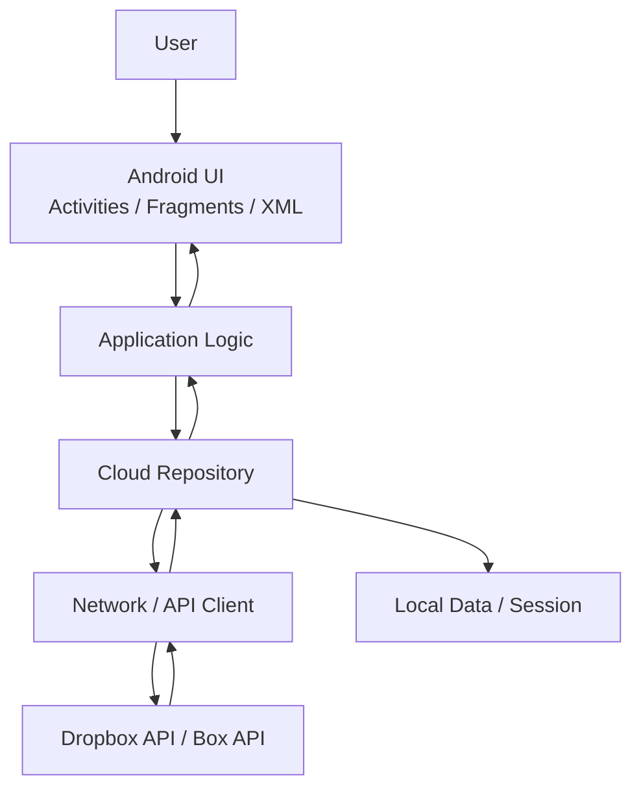
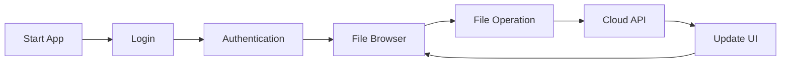

# Dropbox-Box-Client-Android
Android mobile application for browsing, uploading, downloading and managing files on a cloud storage service such as Dropbox or Box

## About the Project

This project is developed as a group project for the
**Mobile Application Development** course at USTH.

The goal of the project is to build an Android mobile application
that works as a client for a cloud storage service such as
**Dropbox or Box**.

The application allows users to access and manage their cloud files
from an Android device.

---

## Project Objectives

The application aims to provide the following main functions:

- User authentication with a cloud storage service
- Browse files and folders
- Open folders
- Upload files
- Download files
- Create folders
- Rename files or folders
- Delete files or folders
- Refresh cloud data

Additional features may be implemented later:

- File search
- File preview
- Upload/download progress
- Offline file information
- Shared links
- Multiple cloud providers

---

## Technology Stack

### Android

- Android Studio
- Java
- XML Layouts
- Android SDK

### Android Components

- Activity
- Fragment
- View / ViewGroup
- Intent
- Android Resources
- AndroidManifest.xml

### Networking

The application communicates with the cloud service through HTTP APIs.

Planned technologies:

- HTTP/REST requests
- JSON data representation
- Cloud provider API
- Android Internet permission

The final networking library will be selected during implementation.

### Background Processing

Network operations and file transfers must not block the Android
main/UI thread.

Background processing will therefore be used for:

- Loading file lists
- Uploading files
- Downloading files
- Refreshing cloud data

---

## Planned Features

| Feature | Description | Status |
|---|---|---|
| Authentication | Sign in to cloud storage account | Planned |
| File Browser | Display files and folders | Planned |
| Folder Navigation | Navigate through cloud folders | Planned |
| Upload | Upload a file to cloud storage | Planned |
| Download | Download a cloud file | Planned |
| Create Folder | Create a new folder | Planned |
| Rename | Rename file/folder | Planned |
| Delete | Delete file/folder | Planned |
| Refresh | Reload cloud file information | Planned |
| Search | Search files | Optional |
| File Preview | Preview supported files | Optional |

---

# System Architecture

The application follows a simple layered architecture.



---

## Application Flow



Example:

User

→ Android Activity / Fragment

→ Application Logic

→ Network Client

→ Dropbox / Box API

→ JSON Response

→ Parse Data

→ Update Android UI

---

# Project Structure

```text
app/
└── src/
    └── main/
        │
        ├── java/
        │   └── vn/edu/usth/cloudbox/
        │       │
        │       ├── ui/
        │       │   ├── login/
        │       │   ├── files/
        │       │   └── settings/
        │       │
        │       ├── model/
        │       │
        │       ├── network/
        │       │
        │       ├── repository/
        │       │
        │       ├── storage/
        │       │
        │       └── utils/
        │
        ├── res/
        │   ├── layout/
        │   ├── drawable/
        │   ├── mipmap/
        │   ├── values/
        │   └── menu/
        │
        └── AndroidManifest.xml
```

### Package Responsibilities

#### `ui/`

Contains Android screens and user-interface components.

Examples:

- LoginActivity
- MainActivity
- FileListFragment
- SettingsActivity

#### `model/`

Contains application data models.

Examples:

- CloudFile
- CloudFolder
- UserAccount

#### `network/`

Responsible for communication with the cloud API.

Examples:

- API requests
- HTTP connection
- JSON responses

#### `repository/`

Connects application logic with cloud/network data.

#### `storage/`

Handles local application data and session information.

#### `utils/`

Contains reusable helper classes.

---

# Android Screens

Initial planned screens:

1. Login Screen
2. File Browser Screen
3. File Details Screen
4. Upload Screen / File Picker
5. Settings / Account Screen

---

# Running the Application

## Requirements

- Android Studio
- Android SDK
- Java
- Git
- Internet connection
- Android emulator or physical Android device

## Clone Repository

```bash
git clone <repository-url>
```

Open Android Studio.

Select:

```text
File
→ Open
→ Dropbox-Box-Client-Android
```

Wait for Gradle synchronization to complete.

Then select an Android emulator or connected Android device.

Press:

```text
Run ▶
```

---

# API Configuration

The application will communicate with the selected cloud provider API.

API credentials and secret information MUST NOT be committed directly
to the GitHub repository.

Configuration instructions will be added after the cloud provider and
authentication method are finalized.

---

# Git Workflow

The main stable branch is:

```text
main
```

Development work should be performed on separate branches.

Example:

```text
feature/login
feature/file-browser
feature/upload
feature/download
feature/file-management
```

Typical workflow:

```text
main
  |
  └── feature/your-feature
          |
          ├── commits
          |
          └── Pull Request
                  |
                  └── review
                         |
                         └── main
```

Do not work directly on `main` unless necessary.

---

# Commit Message Convention

Use clear commit messages.

Examples:

```text
feat: add login screen
feat: display cloud file list
feat: implement file upload
fix: handle network error
fix: prevent crash when folder is empty
docs: update architecture diagram
refactor: reorganize network package
```

Avoid unclear commit messages such as:

```text
update
fix
done
abc
test
final
```

---

# Team

| Member | Responsibility | GitHub |
|---|---|---|
| Member 1 | To be assigned | |
| Member 2 | To be assigned | |
| Member 3 | To be assigned | |
| Member 4 | To be assigned | |
| Member 5 | To be assigned | |
| Member 6 | To be assigned | |

Responsibilities will be finalized after the initial architecture
and feature list are agreed upon.

---

# Development Status

Current phase:

**Project initialization and architecture design**

Next milestones:

1. Initialize Android Studio project
2. Select Dropbox API or Box API
3. Implement authentication
4. Implement cloud file listing
5. Implement upload/download
6. Complete file management features
7. Testing
8. Final demo and presentation

---

# Course

**Mobile Application Development**

University of Science and Technology of Hanoi (USTH)

Group Project – Dropbox / Box Client
