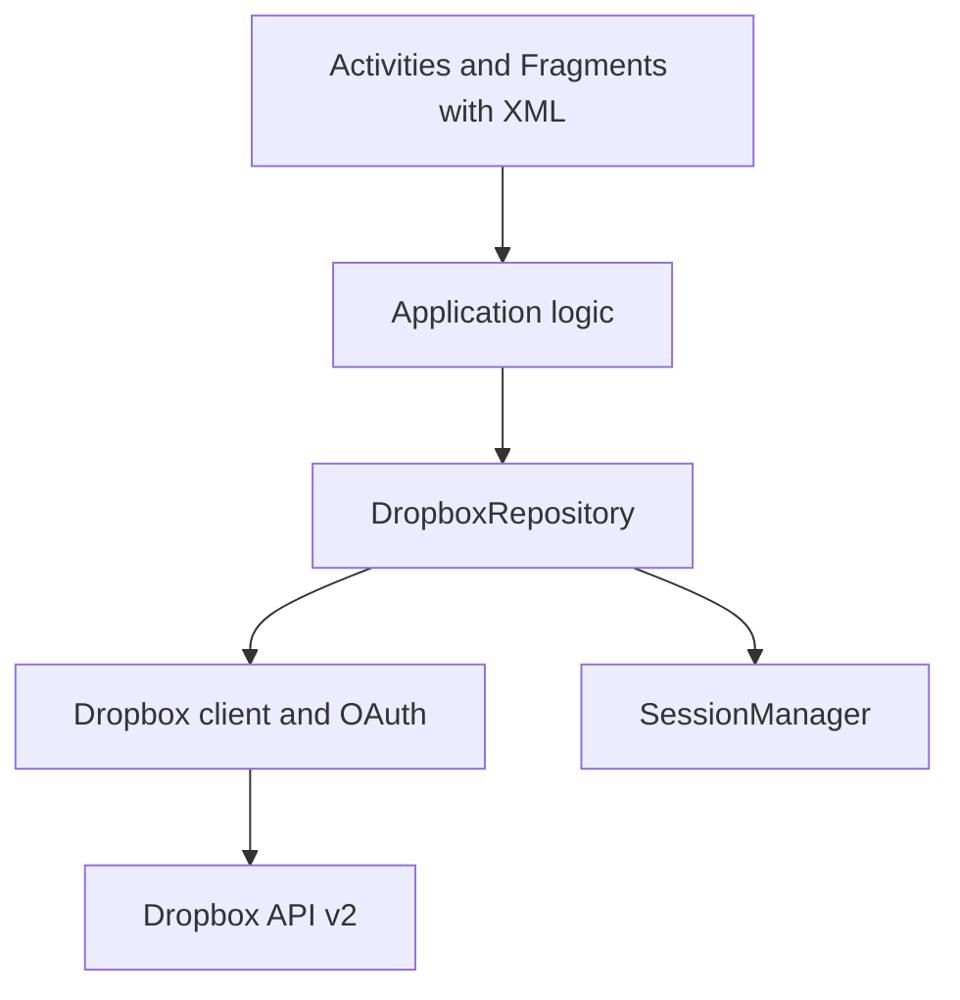

# Dropbox Client Android

Android group project for the Mobile Application Development course at USTH. The app lets users sign in to Dropbox and manage their own cloud files using **Java and XML layouts**.

## Project status and scope

The project is currently in **Milestone 1: GitHub and Android skeleton**. The Java/XML skeleton is implemented and merged into `main`; Dropbox OAuth and all live API operations remain planned. Only Dropbox is in scope. Box, multiple providers and offline synchronization are excluded from the MVP. No custom backend, Firebase or Compose is planned.

### Current implementation

- Confirmed package and application ID: `vn.edu.usth.dropboxclient`.
- `LoginActivity` is the launcher and contains a demo-only button that opens `MainActivity`.
- `MainActivity` hosts `FileBrowserFragment` and `AccountFragment` with working Files / Account navigation.
- The two fragments currently show placeholder content; no Dropbox account or file data is loaded.
- The project builds and runs on a Pixel 6 emulator with Android 14 (API 34).
- Local validation on 18 October 2026: `assembleDebug` passed, lint reported 0 errors and 6 warnings, and the generated unit test passed 1/1.

Milestone 1 remains open until another team member completes a clean clone, Gradle sync, build and run.

## Feature priorities

| Priority | Features | Acceptance criteria |
|---|---|---|
| MVP | Dropbox login, logout, account information | Authorize through Dropbox; show account; clear local session on logout |
| MVP | File/folder browser, folder navigation, refresh | Browse root and nested folders; return to parent; handle pagination and empty folders |
| MVP | Create folder, rename, delete | Validate names; show conflicts; confirm deletion; refresh after success |
| MVP | Upload and download | Select a local file and destination using Android file pickers; verify uploaded/downloaded content |
| MVP | Loading, empty and error states | No crash on cancellation, network failure or expired authorization; allow retry |
| Optional after MVP | Search, shared links, image/PDF preview, transfer percentage, dark mode | Separate issues; implement only after MVP passes |
| Out of MVP | Offline cache/sync, multi-provider support | No delivery commitment |

## Technology and architecture

- Java, XML, Android Studio, Activity, Fragment, Intent and Android resources. RecyclerView is planned for the file browser.
- `minSdk` 26, `targetSdk` 36 and `compileSdk` 36.1.
- Java 11 source compatibility; Gradle uses a Java 21 toolchain. Android Studio's bundled JBR 21 is the recommended build JDK.
- Dropbox API v2 over HTTPS and the official Java/Android SDK are planned but not yet added. SDK objects will represent API responses; the presentation must still explain HTTP, JSON and OAuth.
- Simple layered design. Application logic stays small; do not create a controller class for every action without a need.
- Background network/file I/O with an executor and delivery of UI updates on the main thread. Handle lifecycle changes and stale callbacks. AsyncTask is not the planned implementation.



Currently, `LoginActivity` provides demo navigation to `MainActivity`, which hosts `FileBrowserFragment` and `AccountFragment`. Milestone 2 will replace the demo action with Dropbox OAuth. Create, rename and delete will use dialogs. Upload/download will use system file pickers; separate upload/details/preview screens are not required for MVP.

### Current structure

The package name is confirmed as `vn.edu.usth.dropboxclient`. The current source structure is:

```text
Dropbox-Client-Android/
├── app/src/main/
│   ├── java/vn/edu/usth/dropboxclient/
│   │   ├── ui/login/LoginActivity.java
│   │   ├── ui/main/MainActivity.java
│   │   ├── ui/files/FileBrowserFragment.java
│   │   ├── ui/account/AccountFragment.java
│   ├── res/
│   │   ├── layout/activity_login.xml
│   │   ├── layout/activity_main.xml
│   │   ├── layout/fragment_file_browser.xml
│   │   ├── layout/fragment_account.xml
│   │   ├── drawable/
│   │   ├── mipmap/
│   │   ├── values/
│   │   └── xml/
│   └── AndroidManifest.xml
├── gradle/wrapper/
├── gradlew
├── gradlew.bat
├── README.md
└── .gitignore
```

The `model`, `dropbox`, `storage` and `utils` packages will be created only when their implementations begin. Before parallel API work, agree on repository contracts for list, account, create, rename, delete, upload and download operations. Exact Java signatures, callback types and cancellation rules are still open. UI code must not scatter SDK calls across screens. One owner coordinates edits to the shared repository.

## Milestones and team

Milestones are completion gates, not calendar deadlines. There are nine gates M0–M8.

| Gate | Deliverable | Completion evidence |
|---|---|---|
| M0 | Scope and roles | MVP, owners and open decisions recorded |
| M1 | GitHub and Android skeleton | Clean clone builds/runs; contracts and toolchain agreed |
| M2 | Dropbox configuration and OAuth | Login, account, cancellation and logout verified |
| M3 | File browser | Root, nested/empty folders, back navigation, pagination verified |
| M4 | File operations | Create, rename, conflict handling and confirmed delete verified |
| M5 | Transfers | Small-file upload/download and failure recovery verified |
| M6 | Integration and UI | Complete flows; loading/error/empty states; lifecycle handling |
| M7 | Testing | Test matrix and regression results recorded; critical bugs fixed |
| M8 | Documentation and demo | README, architecture, slides and rehearsed demo match the app |

| Member placeholder | Technical ownership | Review partner |
|---|---|---|
| 1 | Skeleton, navigation, contracts and integration | 3 |
| 2 | OAuth, account data and session | 6 |
| 3 | RecyclerView, pagination and folder navigation | 1 |
| 4 | Upload/download, file URI handling and transfer errors | 5 |
| 5 | Create/rename/delete and validation | 4 |
| 6 | Account UI, shared UI states and regression support | 2 |

Replace placeholders with names/GitHub handles at M0. All members write code, test their module, review PRs and contribute to README/slides. After M1, members can use mocks against agreed contracts while OAuth is being implemented; live integration depends on M2. Optional preview remains optional for Member 6.

## API configuration

1. Create a scoped app in the [Dropbox App Console](https://www.dropbox.com/developers/apps). **Full Dropbox is proposed** for browsing existing user files; App Folder is the alternative for an isolated demo. Confirm the access type before app creation and use a dedicated test account.
2. Enable only required scopes: `account_info.read`, `files.metadata.read`, `files.metadata.write`, `files.content.read`, `files.content.write`. Add sharing scopes only if shared links are approved. Reauthorize after scope changes as required.
3. Use OAuth 2.0 authorization code flow with PKCE. Do not embed an app secret or use a manually generated personal token as the application's login flow.
4. Proposed local configuration in ignored `local.properties`: `DROPBOX_APP_KEY=YOUR_APP_KEY`. Member 1 must implement Gradle property loading and pass the value to the SDK and OAuth manifest callback configuration. A property alone does not configure the app. The app key is a public client identifier, not a secret.
5. Add `android.permission.INTERNET`. Configure the SDK OAuth Activity/redirect intent filter exactly as required by the selected SDK; ensure scheme/redirect registration matches. Test return from browser/Dropbox authorization, cancellation and activity recreation. Do not guess a universal callback URI.
6. Define session persistence and refresh policy before M2. If refresh credentials are required, request the appropriate offline authorization and securely persist them. Clear credentials and in-memory clients on logout; document whether account access is also revoked.
7. Pin a compatible SDK version after checking JDK, AGP, Gradle and minSdk. The official SDK currently documents v8 as Java 21+ and Android API 26+, and directs Java 8–20 projects to compatible 7.x. It requires SDK v7+ for server compatibility. Do not copy old tutorial versions or use a dynamic version.

Source: [official SDK setup](https://github.com/dropbox/dropbox-sdk-java), [OAuth guide](https://docs.dropboxapi.com/dropbox-api/docs/oauth), [file access guide](https://docs.dropboxapi.com/dropbox-api/docs/file-access). Recheck compatibility when selecting the dependency.

## Setup and running

Requirements:

- Android Studio with Android SDK 36.1 installed.
- JDK 21 for Gradle. The JBR bundled with Android Studio is recommended.
- Android emulator or physical device running Android 8.0 (API 26) or later.

1. Clone the repository:

   ```powershell
   git clone https://github.com/NamICT135/Dropbox-Client-Android.git
   ```

2. Open the cloned repository root in Android Studio and wait for Gradle sync.
3. Allow Android Studio to create the machine-specific, ignored `local.properties` file.
4. Select a compatible emulator or device and run the `app` configuration.
5. Verify the current demo flow: Login screen → Continue to demo → Files / Account navigation.

Dropbox configuration is not required for the current skeleton. Do not paste tokens or credentials into source files.

Use the committed Gradle wrapper. On Windows, run:

```powershell
.\gradlew.bat assembleDebug lintDebug testDebugUnitTest
.\gradlew.bat connectedDebugAndroidTest
```

The first line was verified locally on 18 October 2026. `connectedDebugAndroidTest` still requires a running device/emulator and configured instrumentation tests. A successful build does not establish live OAuth/API correctness.

## Git and GitHub workflow

- Invite the other five members as collaborators; use Issues with owner, acceptance criteria and milestone. Track To do → In progress → Review → Done.
- Keep `main` stable. Work on `feature/auth`, `feature/file-browser`, `feature/upload-download`, `feature/file-operations`, `feature/account`, or `feature/ui-testing`; use `fix/...` for focused fixes.
- Update from `main`, implement a small task, inspect the diff, commit and push your branch, then open a PR. Require a peer review and relevant build/test evidence before merging. Enable branch protection where available; do not push directly to `main`.
- PRs describe behavior, screenshots for UI changes, test evidence and known limits. Coordinate shared files such as Gradle, Manifest, navigation and DropboxRepository with their owners.
- Use clear messages such as `feat: paginate Dropbox folders`, `fix: handle cancelled login`, `docs: explain OAuth setup`. Avoid messages such as `update` or `done`.
- Commit wrapper files. Ignore local.properties, build output, tokens, keystores and personal credentials. Never force push shared branches or rewrite shared history.

## Technical and security rules

- No network or heavy file I/O on the main thread; update views only on the main thread. Cancel or ignore stale results when screens change; preserve current folder on rotation.
- Follow `has_more` and cursor continuation; handle rate limits with bounded backoff and actionable errors. Do not blindly retry destructive operations after an uncertain result; refresh first.
- Use Storage Access Framework and ContentResolver streams, not assumed filesystem paths from content URIs. Close streams and avoid reading whole files into memory. Do not request broad storage access for the MVP.
- Start with small demo files. Decide and document a supported size limit at M1; reject oversized input clearly. Large upload sessions, persistent background transfers and process-death recovery are not committed MVP features.
- Validate names and conflicts; confirm delete. Disable duplicate submissions. Do not silently overwrite files.
- Keep strings/dimensions/colors in resources. Handle loading, empty and error states consistently.
- Never commit/log access tokens, refresh tokens, app secrets, passwords or authorization responses. Keep persisted credentials in app-private encrypted storage with keys protected by Android Keystore; exclude credential material from backup. Exact storage implementation is TBD at M2.
- Use HTTPS; never disable certificate checks. Use disposable demo data. If credentials leak, revoke/rotate them immediately; deleting a file in a later commit does not remove the leak.

## Testing and demo checklist

Every module owner records expected/actual result, device/API level and evidence. Unit-test meaningful pure logic (paths, validation, error mapping); test UI/lifecycle and live API integration separately.

- [x] Local Gradle sync and `assembleDebug` complete successfully.
- [x] Lint completes with 0 errors and 6 non-blocking warnings.
- [x] Current unit test passes 1/1.
- [x] Login demo and Files / Account navigation run on Pixel 6 API 34.
- [ ] Clean clone, configuration and Gradle sync work on a second member's machine.
- [ ] Login success/cancel, expired authorization/refresh, logout and relaunch behave correctly.
- [ ] Root, nested and empty folders; back navigation; pagination and Vietnamese filenames work.
- [ ] Create/rename/delete, name conflicts and delete cancellation work on test data.
- [ ] Upload/download contents are correct; picker cancellation and transfer failures are handled.
- [ ] No Internet, rate limits, rapid taps and screen rotation produce no crash or stale UI.
- [ ] Full MVP build/lint/tests pass; final emulator demo is rehearsed; no credentials appear in logs/slides/repo.
- [ ] Presentation follows Introduction → Architecture → Activities → Networking → Optimization → Demo → Conclusion. Course slides specify 15 minutes plus 3 minutes Q&A; demonstrate actual optimization evidence such as UI overdraw rather than claiming unmeasured performance gains.

## Decisions still open

Names/handles, deadlines, license, Dropbox access type, exact Dropbox SDK version, OAuth callback configuration, credential storage implementation and supported transfer size remain open for M0–M2. Full Dropbox is still a proposal. The repository currently contains only the verified Android UI skeleton; OAuth, Dropbox API access and MVP file operations are not implemented.

## Course references

The supplied slides cover Android fundamentals, resources, background tasks, networking and touch input. Course Introduction identifies Dropbox/Box as a topic, requests initial GitHub instructions and meaningful commits, and supplies the presentation structure. Its slide says five students per group; this plan follows the requested six-person team, which should be confirmed with the lecturer. Modern implementation choices preserve the slide principles without copying legacy APIs blindly.
